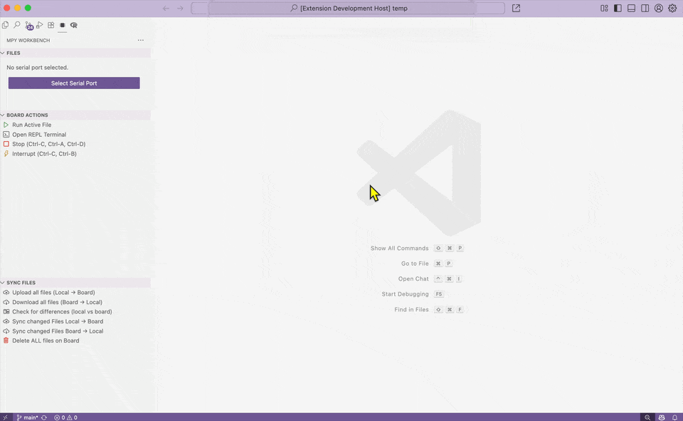
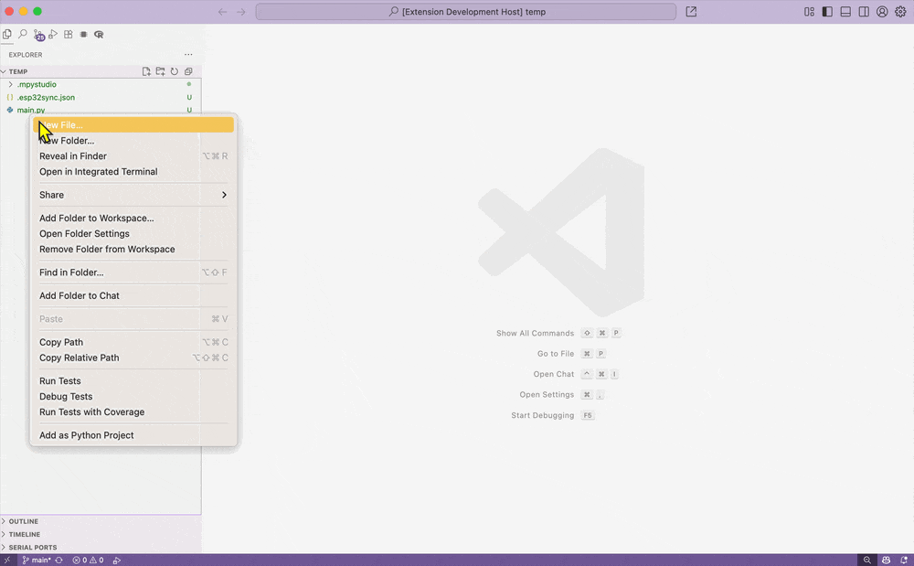

# MPY Workbench — MicroPython file manager for VS Code
**Professional MicroPython Tooling with Thonny’s Simplicity**

**MPY Workbench** bridges the gap between the power of VS Code and the "it just works" experience of **Thonny**. Built on top of the official **mpremote** engine, it provides a stable, high-performance workflow for professional MicroPython development without the CLI friction.

## Main features

- 📂 Remote file explorer for the device (open, download, upload, rename, delete)
- 🔄 Two-way sync: compare local files with the device and sync changed files
- 📝 Create a new file in the Files view and upload it to the board on first save
- 💻 Integrated MicroPython REPL terminal
- ⏯️ Send commands to the board (stop, soft reset, etc.)

**⚡ Connect to board and run a file**

**🔄 Autosync local folder contents**

## Sync utilities

These commands perform full or incremental synchronization between your local workspace and the connected MicroPython board:

- **Upload all Local → Board:** Uploads all non-ignored local files to the device.
- **Download all Board → Local:** Downloads all board files, overwriting local copies.
- **Delete all files on board:** Removes all files on the device.

## Keyboard shortcuts

While a serial port is selected (Thonny-style, disable with `mpyWorkbench.thonnyShortcuts`):

- `F5` — run the active Python file on the board
- `Ctrl+F2` (`Cmd+F2` on macOS) — stop the running program

## Port busy while a program runs

A program started with **Run file** keeps the serial port open, so uploads and auto-sync fail until you stop it. Enable `mpyWorkbench.autoStopBeforeBoardAction` to stop it automatically (Ctrl-C) before uploads, auto-sync on save, Run file, Stop and Soft reset. It is off by default so nothing interrupts a running program without you asking.

## Useful commands (Command Palette)

- `MPY Workbench: Refresh` — refresh the file tree
- `MPY Workbench: Upload Active File` — upload the current editor file
- `MPY Workbench: Select Serial Port` — pick device port
- `MPY Workbench: Open REPL Terminal` — open MicroPython REPL
- `MPY Workbench: Toggle workspace Auto-Sync on Save` — enable/disable workspace auto-sync

## Workspace config

The extension stores per-workspace settings and manifests inside a workspace folder named `.mpy-workbench` at your project root.

- Workspace override file: `.mpy-workbench/config.json`
- Sync manifest: `.mpy-workbench/esp32sync.json`

### Sync only a subfolder

Set `mpyWorkbench.localRoot` (e.g. `device`) to sync only that folder with the board root (`mpyWorkbench.rootPath`). Everything else in the workspace (docs, tests, tooling) stays local. `.mpyignore` patterns are relative to this folder.

### Symlinks

Symlinked files and folders are uploaded as real files, so you can link shared libraries into your project. "Download all" never writes through a local symlink, so the linked originals are not overwritten.

Use the command `MPY Workbench: Toggle workspace Auto-Sync on Save` to enable or disable auto-sync for the current workspace. If no workspace config exists the extension falls back to the global setting `mpyWorkbench.autoSyncOnSave` (default: `false`).

## Python Requirements

- **mpremote** (>= 1.26) — Used internally for all board operations (file management, REPL connection, command execution). Older versions (e.g. 1.24.x) can cause the error `path, next_command` on Upload all files, Download all files, and Check for differences.
- **Install or upgrade:** `pip install -U mpremote`

The Python path used by the extension can be adjusted in the extension settings if a specific interpreter needs to be selected.

## Restricted Mode (untrusted workspaces)

In an untrusted workspace, `mpyWorkbench.pythonPath`, `mpyWorkbench.connect` and `mpyWorkbench.rootPath` are read only from your user settings, never from the workspace's `.vscode/settings.json`. This prevents a cloned repository from choosing which executable or device the extension uses. Trust the workspace to use its own settings.

## Troubleshooting

Logs are written to the **MPY Workbench** output channel (`MPY Workbench: Show Log`). Enable `mpyWorkbench.debugLogging` for detailed messages.

## 🗺️ Roadmap
Currently tested on ESP32-S3 and ESP32-C3.
- [ ] Broaden board compatibility (RP2040, STM32).
- [ ] Integrated firmware flashing.
- [ ] Full Windows validation (COM ports, file operations and REPL).

## 🤝 Contributing
This project is in active development. I use it daily for my professional projects and aim to respond to issues and PRs quickly. If you find a bug or have a feature request, please open an issue.

## License
MIT — see the `LICENSE` file in this repository.
